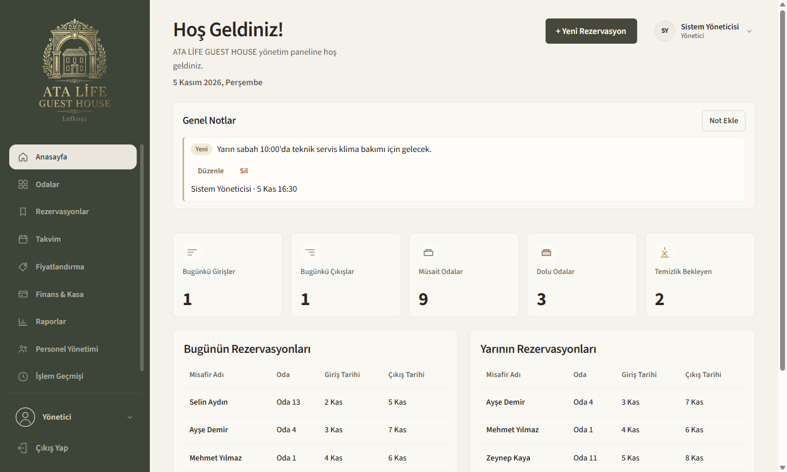
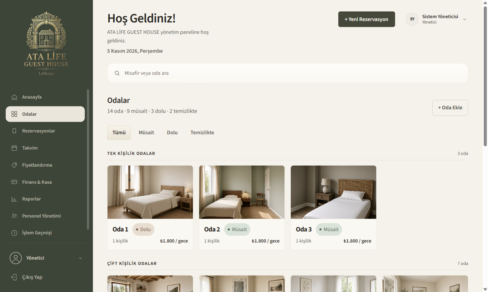
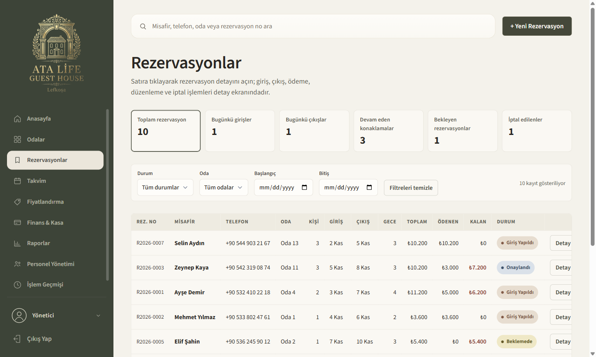
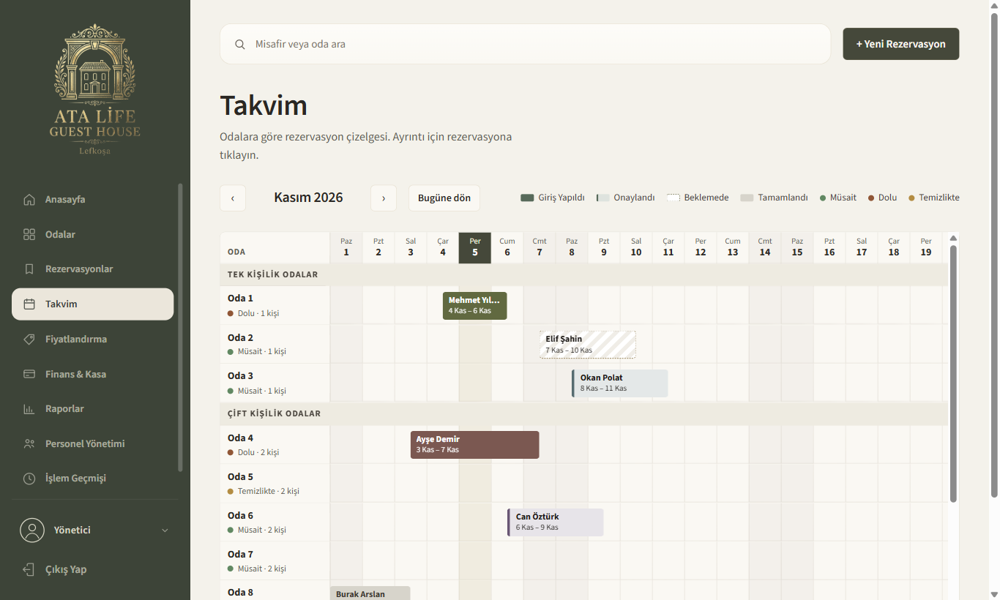
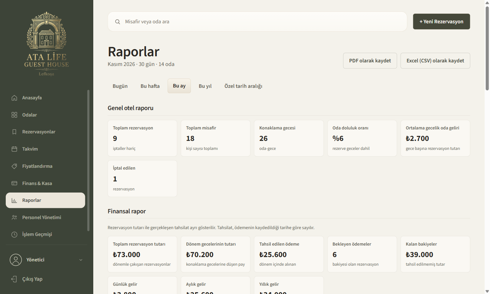
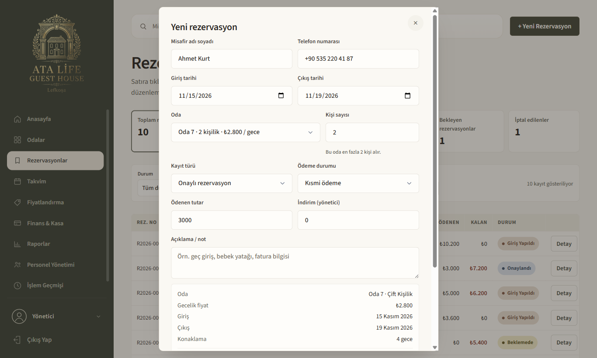

# ATA LİFE Guest House – Otel Yönetim Sistemi

Butik bir otel için geliştirilmiş, Windows masaüstünde çalışan bir otel yönetim sistemi (PMS). Rezervasyon, oda durumu, takvim, fiyatlandırma, ödeme takibi ve raporlama tek bir uygulamada toplanır.



> Ekran görüntülerindeki misafir adları, telefonlar ve tutarlar tamamen hayalidir.

## Özellikler

**Rezervasyon yönetimi**
- Yeni rezervasyon, düzenleme, iptal, oda değiştirme, giriş (check-in) ve çıkış (check-out)
- Rezervasyon durumları: Onaylandı, Beklemede, Giriş Yapıldı, Tamamlandı, İptal Edildi
- Otomatik rezervasyon numarası (ör. `R2026-0001`)
- Aynı odaya çakışan tarihlerde ikinci rezervasyon ve oda kapasitesini aşan kişi sayısı engellenir
- Misafir adı, telefon, oda ve rezervasyon numarasına göre arama; durum, oda ve tarih aralığına göre filtreleme
- Her rezervasyona birden fazla ödeme (nakit, kart, havale) ve not eklenebilir

**Fiyatlandırma ve ödeme**
- Her odanın kendine ait gecelik fiyatı vardır
- Fiyat, rezervasyon anında kaydedilir; sonradan yapılan fiyat değişiklikleri eski rezervasyonları etkilemez
- Gece sayısı, indirim, ödenen ve kalan tutar otomatik hesaplanır
- Kurallara dayalı fiyat öneri sistemi: doluluk, sezon, hafta sonu talebi ve benzer odalarla karşılaştırmaya göre öneri sunar; yönetici onaylamadan fiyat değişmez

**Odalar ve takvim**
- Odalar kapasiteye göre gruplanır: tek, çift ve üç kişilik
- Oda durumu (Müsait, Dolu, Temizlikte) tek tıkla değiştirilir; giriş yapıldığında Dolu, çıkışta Temizlikte olur
- Konaklayan misafiri olan odanın durumu yanlışlıkla Müsait yapılamaz
- Oda bazlı yatay takvim çizelgesi: rezervasyonlar renkli bloklar hâlinde gösterilir

**Raporlar**
- Bugün, bu hafta, bu ay, bu yıl ve özel tarih aralığı
- Genel otel, finansal, oda performansı, misafir ve rezervasyon raporları
- Rezervasyon tutarı ile gerçekleşen tahsilat ayrı hesaplanır
- PDF ve Excel (CSV) olarak dışa aktarma

**Kullanıcılar ve güvenlik**
- Yönetici ve personel rolleri; personel finans, fiyat ve sistem ayarlarına erişemez
- Şifreler salt eklenerek SHA-256 ile saklanır
- Önemli işlemler, yapan kişinin adıyla işlem geçmişine kaydedilir
- Veri yapısı değişikliklerinde önce yedek alan, hata olursa geri alan güvenli veri taşıma (migration)
- Tüm kayıtları tek bir JSON dosyasına yedekleme

## Ekran görüntüleri

| Odalar | Rezervasyonlar |
|---|---|
|  |  |

| Takvim | Raporlar |
|---|---|
|  |  |

**Yeni rezervasyon ve otomatik fiyat hesabı**



## Kullanılan teknolojiler

| Alan | Teknoloji |
|---|---|
| Arayüz | HTML5, CSS3 (Grid, Flexbox, yazdırma stilleri) |
| Uygulama mantığı | JavaScript (ES6+, framework kullanılmadan) |
| Masaüstü uygulaması | Electron, Node.js (IPC, preload / contextBridge, PDF çıktısı) |
| Veri saklama | localStorage (JSON), sürüm bazlı veri taşıma |
| Güvenlik | Web Crypto API (SHA-256) |
| Yardımcı araçlar | Python (Pillow) – logo ve ikon işleme, npm |

## Kurulum ve çalıştırma

Gereksinim: [Node.js](https://nodejs.org) (LTS sürümü).

```bash
git clone https://github.com/furkaneneskum/hotel-management-system.git
cd hotel-management-system
npm install
npm start
```

Windows'ta `Masaustu.bat` dosyasına çift tıklayarak da açabilirsiniz; ilk açılışta gerekli dosyalar otomatik kurulur.

**İlk giriş:** kullanıcı adı `admin`, şifre `atalife`. İlk girişten sonra şifreyi değiştirmeniz önerilir.

## Proje yapısı

```
├── index.html          # Sayfalar ve pencereler (modal)
├── style.css           # Tasarım
├── script.js           # Uygulama mantığı
├── electron/
│   ├── main.js         # Masaüstü uygulaması, dosya kaydetme ve PDF çıktısı
│   └── preload.js      # Arayüz ile ana süreç arasındaki güvenli köprü
├── assets/             # Logo, ikon ve oda görselleri
├── Masaustu.bat        # Masaüstü uygulamasını başlatır
└── baslat.bat          # Tarayıcıda çalıştırmak için yerel sunucu (Python gerekir)
```

## Notlar

- Veriler bilgisayardaki uygulama deposunda tutulur; ayrı bir sunucu veya veritabanı gerekmez. Birden fazla bilgisayarın aynı verileri paylaşması için bir sunucu altyapısı eklenmesi gerekir.
- Oda fotoğrafları yapay zekâ ile üretilmiş temsili görsellerdir.

---

## English summary

A desktop property management system (PMS) for a boutique guest house, built with **JavaScript, HTML5, CSS3 and Electron**. Features include reservations with overlap and capacity validation, per-room pricing with price snapshots, a rule-based price suggestion engine, a room timeline calendar, payment tracking, date-filtered reports with PDF/CSV export, role-based access (admin/staff), salted SHA-256 password hashing, an audit log and safe data migrations with automatic rollback.
